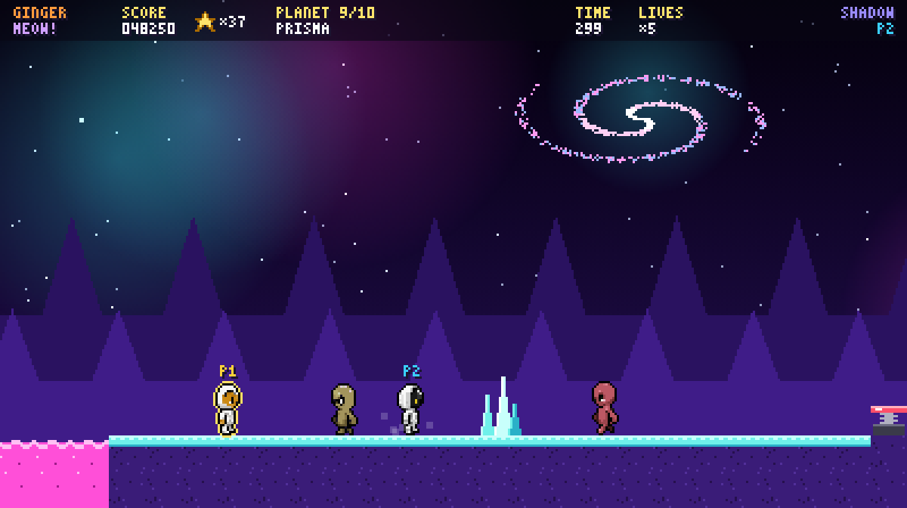

# Space Cats

A 2D pixel-art co-op platformer: one or two cat astronauts hop out of their rocket on 10 planets,
each with its own gravity, hazards and aliens, to get back the last can of SPACE MEOW.
React + Vite on the frontend, Spring Boot + MariaDB for the high-score list.



## Play it

### Option 1: Docker (one command, nothing else to install)

Needs [Docker Desktop](https://www.docker.com/products/docker-desktop/).

```
docker compose up --build
```

Open http://localhost:8000. Docker starts MariaDB, the backend and the game together.
Stop with `Ctrl+C`; scores are kept between runs.

### Option 2: Run it yourself

Needs Node.js 22+, Java 21 and MariaDB.

1. **Backend** (in `backend`): set your MariaDB login and start it. The database and tables are created automatically.
   ```
   set DB_USER=root
   set DB_PASSWORD=your-password
   mvnw spring-boot:run
   ```
   Or run `GameKitApplication` from IntelliJ. Instead of environment variables you can put
   `spring.datasource.username=...` and `spring.datasource.password=...` in
   `backend/src/main/resources/application-local.properties` (ignored by git).
2. **Frontend** (in `frontend`):
   ```
   npm install
   npm run dev
   ```
   Open http://localhost:5173.

The game also runs without the backend: scores are then kept in your browser instead.
`query-install.sql` is optional, for creating a separate database user instead of using root.

## Controls

Pick 1 or 2 players on the title screen, then each player picks a cat.

| | Player 1 | Player 2 |
|---|---|---|
| Move | Left / Right | A / D |
| Jump (hold for higher) | Up | W |
| Run | Right Shift | Space |

Playing alone, both sets of keys work. `Enter` starts, `P` pauses, `M` mutes.
In 2 player mode the camera follows both cats, and a cat who falls floats back in a bubble
as long as the other one is still standing (press jump to pop it early).

## The planets

| # | Planet | What's special |
|---|---|---|
| 1 | Luna Base | low gravity, long floaty jumps |
| 2 | Mars Dunes | bounce pads and crumbling bridges |
| 3 | Frostbite Comet | slippery ice and tiny ledges |
| 4 | Verdania Jungle | moving platforms over toxic goo |
| 5 | Asteroid Belt | floating rocks, elevators and meteor showers |
| 6 | Orbital Station | conveyor belts and jump-through catwalks |
| 7 | Magmara | lava, crumbling bridges, meteors |
| 8 | Nimbus Giant | cloud floors and strong winds |
| 9 | Prisma | a crystal world with a bit of everything |
| 10 | The Mothership | the final stretch, inside the aliens' ship |

Each planet has its own three aliens. Reach the rocket at the end of a planet to fly to the next one.

### Generating the aliens

The aliens are made locally with sprite-forge (see below). With ComfyUI running, run:

```
tools\generate-aliens.bat
```

It makes the 30 planet aliens (1-3 minutes each) and skips ones that already exist, so you can
stop it and continue later. Until an alien is generated the game shows a recolored copy of the
original three aliens. `tools\generate-aliens.bat tux` also redraws Tux with a clear helmet.

## Checking content

`npm run check` (in `frontend`) validates `config.js` and `levels.js`: every level must be
completable (no gaps too wide for that planet's gravity, the rocket reachable from the start, and so on),
then it builds the game.

## How it was made

The game was built with a local, offline AI pipeline on a laptop (RTX 4070, 8 GB) plus Claude:

- **Engine, planets and levels**: the platformer engine (physics, two-player co-op, the rocket scenes, planet
  mechanics like gravity, ice, wind, meteors and conveyors), the space pixel art drawn in code,
  the 10 level layouts and the AI tooling were built with Claude (Anthropic) and tested with automated play-throughs.
- **First version content**: a local coding model (Qwen3-Coder 30B via Ollama + OpenCode) filled in the
  first version's config and levels, guided by an instruction file and the automatic level checker.
- **Sprites**: generated locally with ComfyUI using FLUX.2 [klein] 4B and a pixel-art sprite-sheet LoRA,
  then cleaned up, color-locked and sliced into animation frames by a script. A local vision model
  (Qwen3-VL 8B) checks each sheet and regenerates bad ones.

## Credits

- Sprite generation: [FLUX.2 [klein] 4B](https://huggingface.co/black-forest-labs) by Black Forest Labs,
  with the [pixel spritesheet LoRA](https://huggingface.co/svntax-dev/pixel_spritesheet_4walk_small_lora_v1) by svntax-dev.

## License

MIT, see [LICENSE](LICENSE).
